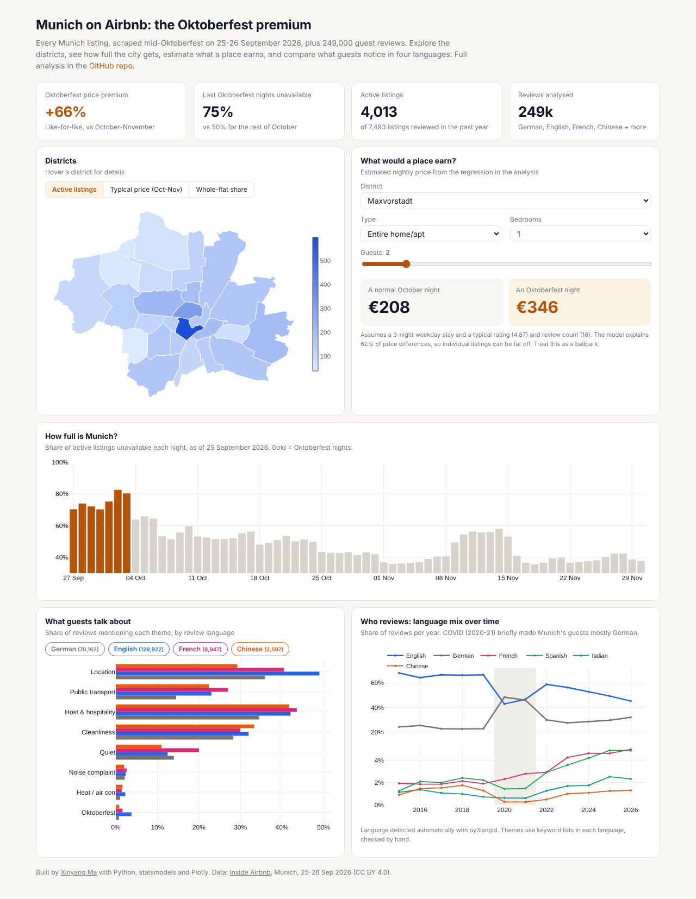
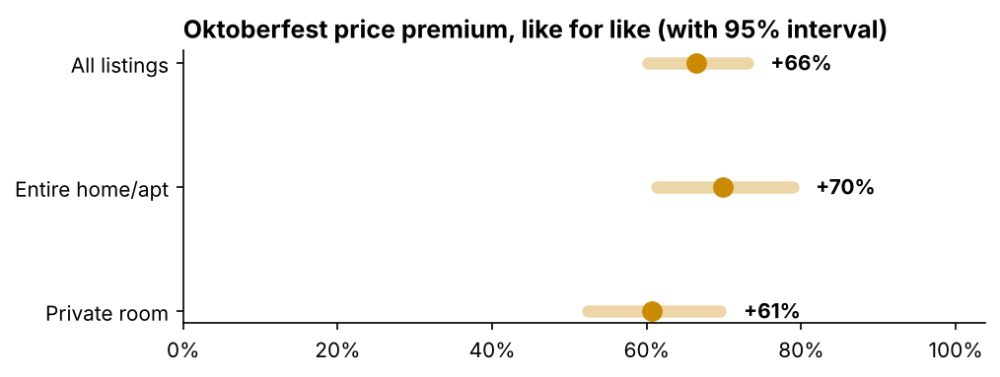
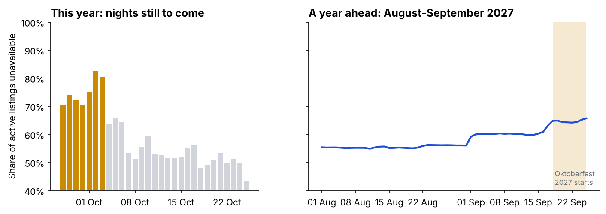
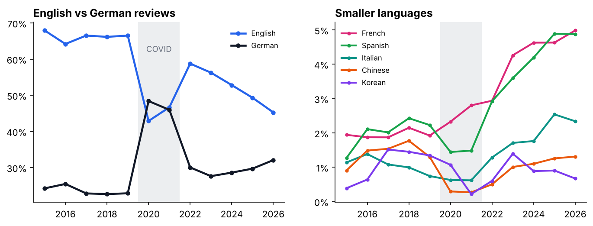
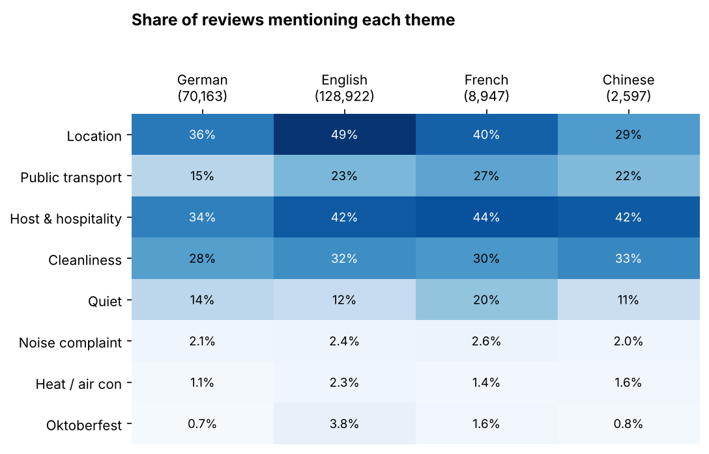

# Munich on Airbnb: the Oktoberfest premium, and what guests say in four languages

Inside Airbnb scraped every Munich listing on 25-26 September 2026, in the middle of Oktoberfest. This project uses that timing to measure what the festival does to prices and occupancy, and reads 249,000 guest reviews in German, English, French and Chinese to see what different guests notice.

**[Open the interactive dashboard](https://xinyangma18.github.io/munich-airbnb/)** · **[Read the full analysis](notebooks/analysis.ipynb)**

[](https://xinyangma18.github.io/munich-airbnb/)

## Key findings

**1. An Oktoberfest night costs about 66% more than a comparable night afterwards** (95% interval +60% to +73%). That figure comes from a hedonic regression on 3,295 real price quotes, controlling for size, room type, district, rating and check-in weekday. The raw medians (280 € vs 160 €) overstate it.



**2. The city fills up.** The last Oktoberfest nights were about 75% unavailable, against about 50% for the rest of October. There are also early signs of bookings for Oktoberfest 2027.



**3. A few hosts earn a large share.** Hosts with five or more listings are 2% of hosts but earn about 30% of estimated revenue.

**4. COVID turned the guests domestic, and long-haul guests were slow to return.** German-language reviews jumped from 23% to 48% in 2020. Chinese reviews fell from 1.3-1.8% before COVID to 0.3%, and are only back to 1.3%. French, Spanish and Italian shares have more than doubled since 2019.



**5. Guests notice different things depending on their language.**
- English speakers mention location most (49%).
- French guests mention public transport (27%) and quiet (20%) most.
- German guests rarely mention transport (15%).
- In summer, heat and missing air conditioning come up in 5.5% of English reviews, twice the German rate.



## How the review analysis works

- Each review's language is detected with `py3langid`.
- Themes are flagged with keyword lists in German, English, French and Chinese, written to avoid common traps: *laut Beschreibung* isn't noise, *pas de bruit* isn't a complaint, and *热情* isn't heat. I spot-checked matches by hand in all four languages.
- It's transparent and auditable, but it isn't sentiment analysis. See [`scripts/prepare_reviews.py`](scripts/prepare_reviews.py).
- The repo only contains the derived table (language and theme flags), not review text or reviewer names.

## Data quality notes

- The calendar has no prices, so prices come from each listing's quote for a specific check-in date. Many of those dates fall during Oktoberfest, which makes the comparison possible.
- 32% of listings have no price and only 54% were reviewed in the past year, so the analysis focuses on active listings.
- "Unavailable" in the calendar means booked *or* blocked, so occupancy figures are upper bounds.
- Only 40 of 7,493 listings show a licence number.

## What's in the repo

| Path | Contents |
|---|---|
| [`notebooks/analysis.ipynb`](notebooks/analysis.ipynb) | Full analysis: market, Oktoberfest effect, reviews |
| [`docs/`](docs) | The dashboard, with district map, price estimator, occupancy and language explorer |
| [`scripts/prepare_reviews.py`](scripts/prepare_reviews.py) | Language detection and theme flags for every review |
| [`data/raw/`](data/raw) | Listings, calendar and district boundaries |
| [`data/processed/`](data/processed) | Review features (no text) |

## Run it yourself

```bash
pip install -r requirements.txt
# optional: put reviews.csv.gz from insideairbnb.com into data/raw/ and rebuild the review features
python scripts/prepare_reviews.py
python scripts/build_notebook.py
jupyter nbconvert --to notebook --execute --inplace notebooks/analysis.ipynb
python scripts/build_dashboard_data.py
```

## Source

[Inside Airbnb](https://insideairbnb.com/get-the-data/), Munich, scraped 25-26 September 2026, licensed CC BY 4.0.

---

Made by [Xinyang Ma](https://github.com/xinyangma18) · [LinkedIn](https://www.linkedin.com/in/xinyang-m-122844288/)
